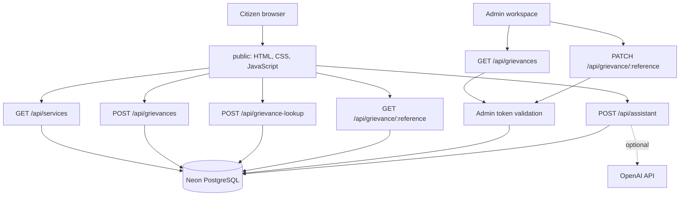

# JANASETU AI — HACK-P438

**Public Grievance AI Assistant | Team Alpha Intelligence**

> **DEMO PROTOTYPE ONLY.** JANASETU AI is a student-built hackathon prototype. It is not an official government website and does not submit complaints to government departments. Use synthetic demonstration data only.

## 1. Project overview

JANASETU AI brings public-service information, bilingual guidance and a demonstrable grievance-tracking workflow into one web application. Citizens can browse service information, ask the assistant for guidance, create a demo grievance, recover its reference number using a mobile number and private lookup PIN, and view status history. An authenticated staff workspace can update demo record statuses.

- **Problem statement:** HACK-P438 — Public Grievance AI Assistant
- **Live application:** https://janasetu-ai-rosy.vercel.app/
- **GitHub repository:** https://github.com/siddarthkasuba-lab/JANASETU-ai
- **Application source directory:** `JANASETU_AI_Vercel_Deployment/`

## 2. Problem statement

People may find public-service information fragmented or difficult to navigate. They may need help identifying relevant guidance, describing an issue clearly, and keeping a reference number for follow-up. The prototype explores a clearer digital journey for information and demonstration tracking.

## 3. Proposed solution

JANASETU AI combines a searchable service directory, an English/Telugu assistant, demo grievance creation, secure reference recovery, public tracking and a token-protected staff workspace. The application demonstrates the workflow; it does not connect to an official grievance department.

## 4. Features

### Citizen experience
- Search and filter curated public-service guides, with official-resource links where available.
- Assistant guidance in English or Telugu based on the question language.
- Optional browser speech recognition for Telugu (`te-IN`) and Indian English (`en-IN`), depending on browser support.
- Create a demo grievance with a generated reference number.
- Recover references using the same Indian mobile number and private 8-digit lookup PIN entered during submission.
- Track a grievance by reference and view its status history.

### Staff experience
- Admin-token-protected grievance listing.
- Update a demo grievance to `Submitted`, `Under Review`, `In Progress`, `Action Required`, `Resolved` or `Closed`.
- Append status events to the grievance history.

### Privacy and abuse safeguards
- Lookup PINs are salted and hashed with Node.js scrypt; the plain PIN is not stored.
- Reference lookup attempts are throttled by a phone/IP hash pair (5 attempts in a 15-minute window).
- Admin endpoints fail closed if a strong server-side admin token is not configured.
- Public tracking responses omit the grievance description.

**Important:** The lookup PIN is not SMS OTP and does not prove ownership of a mobile number. Do not use real sensitive personal data.

## 5. Technology stack

| Layer | Technology |
|---|---|
| Frontend | HTML, CSS, vanilla JavaScript |
| Backend | Node.js serverless API functions on Vercel |
| Database | Neon PostgreSQL via `@neondatabase/serverless` |
| Optional AI provider | OpenAI Chat Completions API |
| Speech input | Browser Web Speech API (browser-dependent) |
| Hosting | Vercel |
| Source control / CI | GitHub and GitHub Actions |

## 6. System architecture

The static frontend in `public/` calls API functions in `api/`. API functions use `lib/db.js` to access Neon PostgreSQL. The assistant can use the optional OpenAI API when configured; otherwise, directory-based fallback guidance may be returned.



## 7. Screenshots

Add current screenshots of the **actual deployed application** to a `screenshots/` directory before final submission. Recommended captures:
1. Home page and service directory.
2. English and Telugu assistant interaction.
3. Demo grievance submission confirmation (use synthetic data).
4. Find My Reference Number form and successful result.
5. Public tracking timeline.
6. Admin workspace showing a saved status update.

Do not include real mobile numbers, lookup PINs, admin tokens, API keys or database credentials in screenshots.

## 8. Local installation and setup

### Requirements
- Node.js 20 or newer
- npm
- A PostgreSQL database (Neon is used by the deployed demo)
- Vercel CLI for local serverless-function development

### Commands

```bash
git clone https://github.com/siddarthkasuba-lab/JANASETU-ai.git
cd JANASETU-ai/JANASETU_AI_Vercel_Deployment
npm install
cp .env.example .env
```

On Windows Command Prompt, use `copy .env.example .env` instead of `cp`.

Set the environment variables below in `.env`. Then execute `db/schema.sql` in the selected PostgreSQL database and start the local Vercel development server:

```bash
npx vercel dev
```

The package script `npm run dev` runs the same command. Local execution requires valid environment configuration and Vercel CLI authentication/configuration as applicable.

## 9. Environment variables

| Variable | Required | Purpose |
|---|---|---|
| `DATABASE_URL` | Yes | PostgreSQL/Neon connection string |
| `JANASETU_ADMIN_TOKEN` | For admin features | Strong random server-side secret, at least 32 characters |
| `OPENAI_API_KEY` | Optional | Enables provider-backed assistant responses |
| `OPENAI_MODEL` | Optional | Model name; defaults to `gpt-4o-mini` |

Generate an admin token locally:

```bash
node -e "console.log(require('node:crypto').randomBytes(32).toString('hex'))"
```

Configure secrets in Vercel Project Settings → Environment Variables and redeploy. Never commit `.env`, real credentials, API keys, database URLs or admin tokens. The admin page prompts for the token and keeps it in memory for the current page session.

## 10. API documentation

Detailed API documentation: [docs/API.md](docs/API.md).

| Method | Endpoint | Purpose | Access |
|---|---|---|---|
| GET | `/api/services` | List/filter service guides | Public |
| POST | `/api/assistant` | Public-service guidance | Public |
| POST | `/api/grievances` | Create demo grievance; requires mobile and 8-digit lookup PIN | Public; validated |
| POST | `/api/grievance-lookup` | Recover references using mobile number + PIN | Public; PIN-verified and throttled |
| GET | `/api/grievance/{reference}` | Track one grievance and its history | Public reference lookup |
| GET | `/api/grievances` | List demo grievances | Admin token required |
| PATCH | `/api/grievance/{reference}` | Update demo status | Admin token required |

Admin endpoints require the `x-admin-token` header. Do not include the token in client source, screenshots or shared API collections.

## 11. Database design

Schema: [db/schema.sql](db/schema.sql). Architecture and ER notes: [docs/architecture.md](docs/architecture.md).

| Table | Purpose |
|---|---|
| `services` | Curated service titles, categories, descriptions, documents, steps and official URLs |
| `grievances` | Demo reference, subject, description, category, location, department, status and creation/update timestamps |
| `grievance_history` | Timestamped status changes and notes linked to a grievance |
| `grievance_lookup_attempts` | Phone/IP hashes and timestamps used to throttle repeated lookup attempts |

The `grievances` table also stores the mobile number and the lookup PIN salt/hash needed for reference recovery. Existing records created before this feature may not have recovery details.

## 12. Testing

Automated tests and syntax checks are configured through GitHub Actions. Run the unit tests from the application directory:

```bash
npm test
```

See [docs/TESTING.md](docs/TESTING.md) for the manual workflow checklist and [GitHub Actions](https://github.com/siddarthkasuba-lab/JANASETU-ai/actions) for CI run history. Only report a test as passed when the corresponding run or manual test has actually succeeded. Verify the live application after each production deployment.

## 13. Deployment

The production demo is hosted on Vercel and uses Neon PostgreSQL.

1. Import this repository into Vercel.
2. Set the Vercel project root directory to `JANASETU_AI_Vercel_Deployment`.
3. Configure `DATABASE_URL` and `JANASETU_ADMIN_TOKEN`; optionally configure `OPENAI_API_KEY` and `OPENAI_MODEL`.
4. Execute `db/schema.sql` against the configured database.
5. Deploy and verify the public workflows and authenticated admin workflows.
6. Ensure evaluators can open the production URL without needing access to your Vercel account.

- **Live app:** https://janasetu-ai-rosy.vercel.app/
- **API base:** https://janasetu-ai-rosy.vercel.app/api

## 14. Team members and contributions

Team name: **Alpha Intelligence**.

The team roster currently referenced by the project submission materials is listed in [docs/SUBMISSION.md](docs/SUBMISSION.md). Before final submission, verify every member's full name, roll number, branch and section against official records, and update the document with each person's **actual** contribution. Do not claim work that a member did not perform.

## 15. Limitations and future scope

### Current limitations
- No official government grievance filing or department integration.
- The records are demonstration records only.
- The mobile-number + PIN flow is not SMS OTP or proof of phone ownership.
- Directory content and external links need periodic human review.
- AI answers depend on optional provider configuration and require human evaluation.
- Browser speech recognition varies by browser and may rely on the browser's speech service.

### Future scope
- Official integrations only with authorization from the relevant departments.
- Verified identity and secure account recovery.
- Formal privacy policy, consent, data-retention and deletion processes.
- Stronger monitoring, audit logging, abuse prevention and independent security review.
- Accessibility testing and broader automated test coverage.

## 16. Privacy, security and responsible use

- Use synthetic data only. Do not enter Aadhaar numbers, passwords, bank information, medical identifiers or other sensitive personal information.
- No complaint is sent to a government department.
- The assistant is not a government authority; verify requirements through linked official sources.
- Keep all secrets in deployment environment settings or a local untracked `.env` file.
- Before any real-world deployment, complete legal/privacy review, threat modelling, independent security testing, accessibility work and authorized government integration.

## 17. Acknowledgements

Built using the Node.js ecosystem, Vercel, Neon PostgreSQL, GitHub Actions and (when configured) the OpenAI API. Browser speech input uses the browser's Web Speech API implementation. Review the applicable documentation, licenses and terms for all external services and resources used.

---

For the demo walkthrough, testing checklist, team submission checklist and presentation outline, see [docs/SUBMISSION.md](docs/SUBMISSION.md) and [docs/TESTING.md](docs/TESTING.md).
