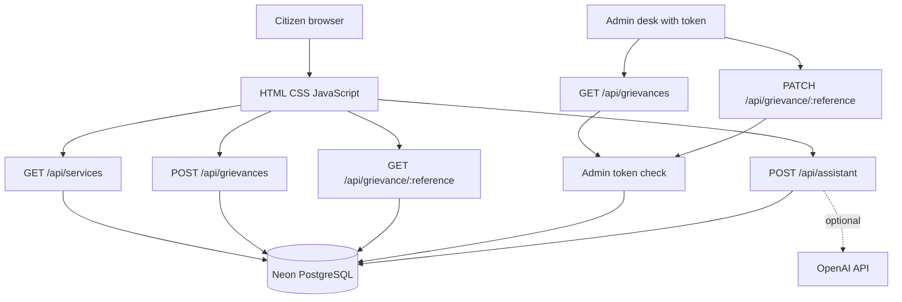

# JANASETU AI — HACK-P438

**Public Grievance AI Assistant | Team Alpha Intelligence**

JANASETU AI is a student-built full-stack prototype that combines a curated public-service directory, English/Telugu guidance, browser speech-to-text, and demo grievance submission and tracking.

> **Important:** This is a student demonstration prototype. It is not an official government website and does not file complaints with government departments. Use synthetic demo data only.

## Live deployment

- Application: https://janasetu-ai-rosy.vercel.app/
- Repository: https://github.com/siddarthkasuba-lab/JANASETU-ai
- App source folder: `JANASETU_AI_Vercel_Deployment/`

## Features

- Search/filter curated public-service guides with official-resource links where available.
- Assistant responses in English or Telugu based on the question language.
- Optional browser speech recognition for Telugu (`te-IN`) and Indian English (`en-IN`). Browser support and internet connectivity may be required; only the recognized transcript is sent to the API.
- Demo grievance creation with validation and a reference number.
- Public reference-based status/history lookup.
- Token-protected admin listing and status changes (requires `JANASETU_ADMIN_TOKEN`).
- PostgreSQL persistence through Neon.

## Technology

- Frontend: HTML, CSS, vanilla JavaScript
- Backend: Vercel Node.js API functions
- Database: PostgreSQL via `@neondatabase/serverless` and Neon
- Optional AI provider: OpenAI Chat Completions API
- Hosting: Vercel

## Architecture



## Local setup

Requirements: Node.js 20 or newer, npm, and a PostgreSQL database.

```bash
git clone https://github.com/siddarthkasuba-lab/JANASETU-ai.git
cd JANASETU-ai/JANASETU_AI_Vercel_Deployment
npm install
cp .env.example .env
npm run dev
```

Before running, fill in `.env` as described below and run `db/schema.sql` in your database SQL editor.

## Environment variables

| Variable | Required? | Purpose |
|---|---|---|
| `DATABASE_URL` | Yes | PostgreSQL/Neon connection string |
| `JANASETU_ADMIN_TOKEN` | Yes for admin functions | Long random secret, at least 32 characters; used for server-side admin authorization |
| `OPENAI_API_KEY` | Optional | Enables generated AI answers; keep it secret |
| `OPENAI_MODEL` | Optional | Model name; defaults to `gpt-4o-mini` |

Never commit `.env`, API keys, database URLs, or the admin token. Configure these in Vercel Project Settings → Environment Variables and redeploy. Admin functions fail closed when the admin token is not configured.

Generate a strong admin token locally:

```bash
node -e "console.log(require('node:crypto').randomBytes(32).toString('hex'))"
```

Store the result only in a password manager and Vercel environment settings. Do not send it in chat, screenshots, GitHub issues, or the demo video. The admin page prompts for the token and keeps it in memory for the current page session only.

## API documentation

Detailed endpoint documentation: [docs/API.md](docs/API.md).

| Method | Endpoint | Purpose | Access |
|---|---|---|---|
| GET | `/api/services` | List/filter service guides | Public |
| POST | `/api/assistant` | Public-service guidance | Public |
| POST | `/api/grievances` | Create a demo grievance | Public; validated |
| GET | `/api/grievance/{reference}` | Track one grievance and its history | Public reference lookup |
| GET | `/api/grievances` | List demo grievances | Admin token required |
| PATCH | `/api/grievance/{reference}` | Update demo status | Admin token required |

Admin requests require header `x-admin-token: <JANASETU_ADMIN_TOKEN>`.

## Database design

- `services`: curated service title, category, guidance, documents, steps and official URL.
- `grievances`: reference, subject, description, category, locality, department, status and demo flag.
- `grievance_history`: timestamped status updates and notes linked to a grievance.

The schema is in [db/schema.sql](db/schema.sql). A reference ER description is in [docs/architecture.md](docs/architecture.md).

## Testing

Run unit tests:

```bash
npm test
```

The current automated unit tests cover admin authorization behavior. Verify deployed service and grievance workflows manually before submission; never describe unrun tests as passed. Follow [docs/TESTING.md](docs/TESTING.md).

## Deployment

1. Import the repository into Vercel.
2. Set the project root directory to `JANASETU_AI_Vercel_Deployment`.
3. Configure `DATABASE_URL`, `JANASETU_ADMIN_TOKEN`, and optionally `OPENAI_API_KEY` and `OPENAI_MODEL`.
4. Run `db/schema.sql` against the configured database.
5. Redeploy and verify public and admin flows.
6. Ensure evaluators can open the deployment without access to your Vercel account.

## Privacy and security limitations

- Demo records are not official government filings.
- Do not enter Aadhaar numbers, passwords, bank information, or other sensitive personal data.
- Admin listing and status changes require the configured admin token.
- Public reference tracking is intended only for synthetic demonstration records. Before handling real citizen data, add proper identity/access design, abuse protection/rate limiting, audit review, data-retention rules, privacy review and security testing.
- The assistant is not a government authority. Verify requirements through linked official sources.
- Browser speech recognition support varies by browser; recognition may be handled by the browser's speech service. Only the recognized text is sent to this application's API.

## Team

Team Alpha Intelligence — confirm all names, roll numbers, branch/section and each member's actual contribution before final submission.

## Limitations and future scope

- No official government grievance submission integration.
- Curated directory content and links require periodic human review.
- AI-generated answers depend on optional provider configuration and must be evaluated for correctness.
- Future work: authenticated staff accounts, stronger rate limiting, audit logging, data-retention controls, broader test coverage, and official integrations only with authorization.

## Acknowledgements

Vercel, Neon PostgreSQL, the Node.js ecosystem, and optional OpenAI API usage. Verify terms and attributions of additional resources before submission.
