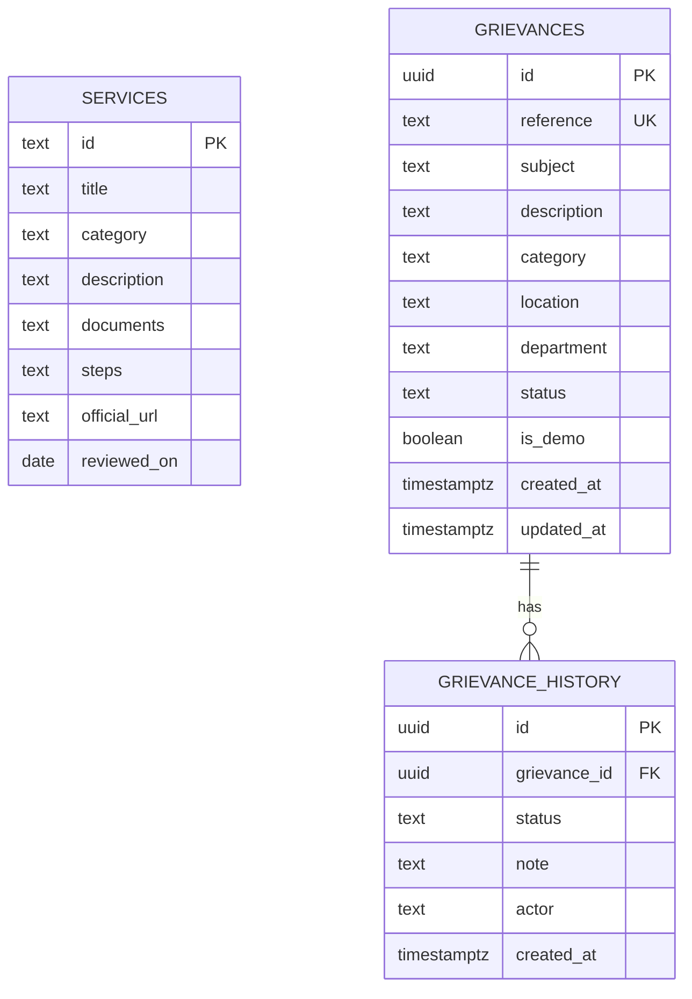

# Architecture and database notes

## Request flow

The browser serves `public/index.html`, `public/theme.css` and `public/app.js`. Frontend actions call Vercel API functions under `api/`. API functions query Neon PostgreSQL through `lib/db.js`.

- Public service directory: `GET /api/services` → `services`
- Assistant: `POST /api/assistant` → curated `services` context → optional OpenAI API
- Demo submission: `POST /api/grievances` → `grievances` + initial `grievance_history`
- Public tracking: `GET /api/grievance/{reference}` → one `grievances` record + `grievance_history`
- Admin list/update: admin-token check → list/update grievance and append history

## Entity relationship

Schema source: `db/schema.sql`. All grievance records created by the public endpoint are marked `is_demo = TRUE`.
